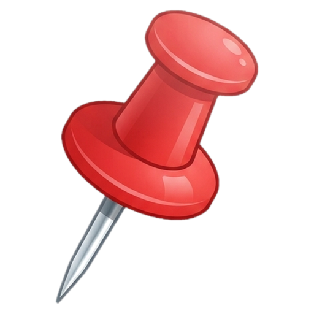

<p align="center">
  
</p>

<h1 align="center">Tacky</h1>

<p align="center">
  <em>A desktop pinboard that slides down from the top of your screen.<br>
  Pin text, screenshots, images and files, then grab them again whenever you need them.</em>
</p>

<p align="center">
  
  
  
  
</p>

<p align="center">
  <a href="https://github.com/C0ding-Craze/tacky/releases/latest"><b>⬇ Download for Windows</b></a>
  &nbsp;·&nbsp;
  <a href="#quick-start">Quick start</a>
  &nbsp;·&nbsp;
  <a href="#shortcuts">Shortcuts</a>
  &nbsp;·&nbsp;
  <a href="#troubleshooting">Troubleshooting</a>
</p>

<!--
  Tip: add a screenshot or short GIF of the board sliding down here.
  <p align="center"></p>
-->

---

## What is Tacky?

Tacky is a lightweight pinboard for Windows. It sits in your system tray until you need it. Move your mouse to the top-centre of the screen (or press a shortcut) and a velvet or cork board slides down with everything you pinned earlier.

Use it as a scratch space for the things you copy, snip and drag around all day. Click a card to copy it again, or drag it straight into another app.

## Features

- **Pin almost anything:** text, screenshots, images and files.
- **One-key pinning:** select text, a file or an image in any app and press `Win + C`.
- **Automatic screenshots:** snips from `Win + Shift + S` or `PrintScreen` land on the board.
- **Drag in, drag out:** drop things onto the board, or drag a card into another app.
- **Click to copy:** one click puts a card's content on your clipboard.
- **Editable sticky notes:** text pins appear as paper notes you can edit.
- **Self-cleaning:** unstarred cards fade after 4 days and expire after 7.
- **Customisable:** five board styles and three reveal speeds.
- **Stays out of the way:** tray-only, single instance, optional start with Windows.

## Quick start

> **Requires** Windows 10 or 11 (64-bit). No Python needed for the ZIP.

1. [Download the latest `Tacky-Windows.zip`](https://github.com/C0ding-Craze/tacky/releases/latest) from the release's Assets section.
2. Extract it anywhere you like.
3. Run `Tacky.exe`.
4. Look for the red pin icon in the system tray, near the clock.

That's it. Press `Win + Alt + S` to open the board.

<details>
<summary><b>Run from source instead</b> (Python 3.10+)</summary>

<br>

```bash
# 1. Get the code
git clone https://github.com/C0ding-Craze/tacky.git
cd tacky

# 2. (Optional) create a virtual environment
python -m venv .venv
.venv\Scripts\activate

# 3. Install the only dependency
pip install PySide6

# 4. Launch
python tacky.py
```

To run without a console window, use `pythonw tacky.py`.

The only third-party package is [PySide6](https://pypi.org/project/PySide6/) (Qt 6), used for the interface, tray icon, drag and drop, and clipboard. Everything else is from the standard library, and Windows APIs are called through `ctypes`.

</details>

## How to use it

### 1. Open the board

Do any one of these:

- Rest your mouse at the **top-centre edge** of your main screen for a moment
- Press `Win + Alt + S`
- Left-click the tray icon

The board hides shortly after your mouse leaves it. Press `Esc` or use the shortcut again to close it right away.

### 2. Pin something

| To pin... | Option 1: keyboard | Option 2: drag |
|---|---|---|
| **Text** | Select it in any app, then press `Win + C` | Drag the selected text onto the board |
| **Files** | Select them in File Explorer, then press `Win + C` | Drag them onto the board |
| **Images** | Select or click the image in an app that copies it with `Ctrl + C`, then press `Win + C` | Drag the image file onto the board |
| **A screenshot** | Take a snip with `Win + Shift + S` or `PrintScreen` (pinned automatically) | n/a |

`Win + C` simply pins whatever the app copies when you select something, so it works for anything that supports `Ctrl + C`. New pins appear at the left end of the board, and the board pops open briefly to show them. After `Win + C`, your previous clipboard contents are restored, so pinning never disturbs what you had copied.

### 3. Use it again

| Action | Result |
|---|---|
| **Click** a card | Copies its content |
| **Drag** a card out | Drops the text, image or file into another app |
| **Double-click** | Opens the file, or edits the note |
| **Right-click** | More actions: Keep, Copy, Edit or Open, Show in Explorer, Unpin |

Hover over a card to lift it and see it larger.

### 4. Keep what matters

Cards start to fade after **4 days** and are removed after **7**. Right-click a card and choose **Keep** to star it and protect it from expiring.

## Shortcuts

| Shortcut | Action |
|---|---|
| `Win + Alt + S` | Show or hide the board |
| `Win + C` | Pin the selected text, file or image |
| `Win + Alt + C` | Fallback pin shortcut, used if `Win + C` can't be captured |
| `Win + Shift + S` | Windows snip (Tacky pins the result) |
| `PrintScreen` | Screenshot (Tacky pins the result) |

If another app already owns a shortcut, Tacky shows a tray notification. Automatic screenshot pinning can be turned off from the tray menu.

<details>
<summary><b>Board controls</b> (keyboard, mouse and note editor)</summary>

<br>

| Input | Action |
|---|---|
| Mouse at top-centre of screen | Reveal the board |
| `Esc` | Hide the board |
| `←` / `→` | Scroll the board |
| Mouse wheel | Scroll sideways |
| Edge arrows (left and right) | Click to step, hold to scroll |
| Right-click the board frame | Clear the **whole** board, including kept cards |

Keyboard keys work while the board has focus, which is the case when you open it with `Win + Alt + S` or the tray icon.

**Note editor:** `Ctrl + Enter` saves, and the Cancel button discards changes.

</details>

<details>
<summary><b>Tray menu</b> (right-click the pin icon)</summary>

<br>

| Item | What it does |
|---|---|
| Show / hide board | Same as `Win + Alt + S` |
| Reveal speed | How long the mouse must rest at the top edge: Instant, Normal or Slow |
| Board style | Green, Blue, Burgundy or Charcoal velvet, or Cork |
| Pin snips | Turn automatic screenshot pinning on or off |
| Start with Windows | Launch Tacky at login |
| Clear board (keeps starred) | Remove every card except the ones you kept |
| Quit | Save and exit |

Left-clicking the tray icon toggles the board.

</details>

## Your data

Tacky stores everything locally and sends nothing over the network.

| What | Where |
|---|---|
| Board data and settings | `%APPDATA%\Tacky\board.json` |
| Pinned images | `%APPDATA%\Tacky\items\` |
| Log file | `%APPDATA%\Tacky\tacky.log` |

- Set the `TACKY_HOME` environment variable to use a different data folder.
- Files you pin by dragging are only **referenced**, not copied, so removing a card never touches your original file.
- Images Tacky saved itself (snips and pasted pictures) are moved to the Recycle Bin when their card is removed or expires.
- If `board.json` is ever corrupted, Tacky saves a copy as `board.bad` and starts with an empty board.

## Troubleshooting

<details>
<summary><b>The board doesn't appear when I move the mouse to the top</b></summary>

<br>

Rest the pointer at the very top edge, in the middle part of your **main** screen, for a moment. You can also use `Win + Alt + S` or click the tray icon.

</details>

<details>
<summary><b><code>Win + C</code> doesn't pin anything</b></summary>

<br>

Make sure something is selected first (text, a file or an image). Tacky works by sending a copy command (`Ctrl + C`) to the active app. If you see *Nothing selected*, the app didn't respond to it. If Tacky can't capture `Win + C`, it switches to `Win + Alt + C` and tells you.

</details>

<details>
<summary><b>A snip wasn't pinned</b></summary>

<br>

Check that **Pin snips** is turned on in the tray menu. Tacky picks up snips from the clipboard right after you use `Win + Shift + S` or `PrintScreen`, and also watches your `Pictures\Screenshots` folder for new images.

</details>

<details>
<summary><b>Tacky says a shortcut is already in use</b></summary>

<br>

Another program has registered the same shortcut. Close it, or use the tray menu instead.

</details>

<details>
<summary><b>Tacky won't start a second time</b></summary>

<br>

Only one copy can run at once. Look for the pin in the tray and quit it from there if needed.

</details>

<details>
<summary><b>Something else isn't working</b></summary>

<br>

Check `%APPDATA%\Tacky\tacky.log`, and include it if you open an issue.

</details>

## For developers

<details>
<summary><b>Project structure</b></summary>

<br>

```text
Tacky/
├── tacky.py                  # Entry point
├── assets/
│   ├── pin.ico               # Windows icon
│   └── pin.png               # App icon
└── app/
    ├── main.py               # Start-up, single-instance lock, tray and hotkey wiring
    ├── board/
    │   ├── window.py         # The sliding board: reveal logic, scrolling, drag and drop
    │   ├── flipper.py        # Show / hide animation
    │   ├── boardart.py       # Board frame and background drawing
    │   ├── textures.py       # Velvet and cork textures
    │   └── overlay.py        # Overlay helper
    ├── cards/
    │   ├── card.py           # Card widget: hover, click, drag, context menu, fade
    │   ├── cardface.py       # Renders each card's face
    │   └── actions.py        # Pin, copy, open, keep, remove, expire
    ├── core/
    │   ├── config.py         # Paths, colours, board styles, expiry settings
    │   ├── store.py          # Items and settings, saved to board.json
    │   ├── log.py            # Rotating log file and error hooks
    │   ├── startup.py        # Start with Windows (registry Run key)
    │   └── memory.py         # Memory trimming
    ├── system/
    │   ├── winkeys.py        # Global shortcuts and the Win + C keyboard hook
    │   ├── capture.py        # Text pinning and screenshot detection
    │   └── tray.py           # Tray icon and menu
    └── ui/
        ├── theme.py          # Stylesheets
        ├── icon.py           # App icon
        ├── painting.py       # Drawing helpers (pins, stars, easing)
        ├── paperdialog.py    # Sticky-note editor
        └── widgets.py        # Scroll bar, edge arrows, styled menus
```

</details>

<details>
<summary><b>How it works</b></summary>

<br>

- **Shortcuts.** `Win + Alt + S` is a standard registered hotkey. `Win + C` is caught with a low-level keyboard hook. If the hook can't be installed, Tacky registers `Win + Alt + C` instead.
- **Text pinning.** Tacky saves your clipboard, sends `Ctrl + C` to the active app, reads the result, then restores the original clipboard.
- **Screenshots.** After a snip shortcut, Tacky watches the clipboard for an image. It also polls `Pictures\Screenshots` for new files, and ignores duplicates within five seconds.
- **Storage.** Cards and settings live in one JSON file, written atomically. A card that fails to load is skipped without losing the rest.
- **Tuning.** Fade and expiry days, board colours, pin colours and note colours are constants in `app/core/config.py`.

</details>

### Contributing

Issues and pull requests are welcome. For larger changes, please open an issue first so we can talk it through.

1. Fork the repository
2. Create a branch: `git checkout -b my-feature`
3. Commit your changes
4. Push the branch and open a pull request

### Platform note

Tacky is built for Windows. The global hotkeys, screenshot hooks and **Start with Windows** option rely on Windows APIs, so they are unavailable on other platforms.

## License

Released under the **MIT License**. See [`LICENSE`](LICENSE) for the full text.

---

<p align="center"><sub>Made with a red pin and too many sticky notes.</sub></p>
